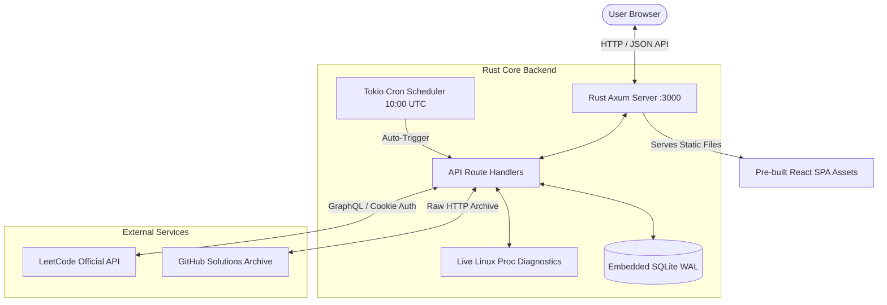

# LeetCode Autonomous Solver

[](https://www.rust-lang.org/)
[](https://github.com/tokio-rs/axum)
[](https://tokio.rs/)
[](https://react.dev/)
[](https://www.docker.com/)
[](LICENSE)

An enterprise-grade, ultra-lightweight autonomous LeetCode daily solver and problem workspace engineered in **Rust** with an interactive **React SPA** frontend. Architected for 24/7 autonomous cloud operations on zero-cost tiers (Render, Railway, Fly.io) with a minimal memory footprint (< 25 MB RSS) and sub-50ms cold starts.

---

## Table of Contents

- [Key Architectural Highlights](#key-architectural-highlights)
- [Application Workspaces & Navigation](#application-workspaces--navigation)
- [System Architecture](#system-architecture)
- [REST API Reference](#rest-api-reference)
- [Local Development Guide](#local-development-guide)
  - [Prerequisites](#prerequisites)
  - [1. Building the Frontend](#1-building-the-frontend)
  - [2. Launching the Rust Backend](#2-launching-the-rust-backend)
  - [3. Headless CLI Operations](#3-headless-cli-operations)
- [Production Deployment](#production-deployment)
  - [Method A: Render Docker Deployment (Recommended)](#method-a-render-docker-deployment-recommended)
  - [Method B: Render Blueprint](#method-b-render-blueprint)
  - [Triggering Manual Deployments](#triggering-manual-deployments)
- [Environment Configuration](#environment-configuration)
- [Automated GitHub Actions Sync](#automated-github-actions-sync)
- [Security & Session Hygiene](#security--session-hygiene)
- [License](#license)

---

## Key Architectural Highlights

- **High-Performance Native Core**: Built with Axum 0.7 and the Tokio async runtime. Compiles to a single static binary with embedded zero-copy frontend asset serving.
- **Authentic LeetCode Problem Workspaces**: Split-pane interactive interface featuring rendered problem HTML, official difficulty/topic tags, multi-language solutions, a code editor, and a live judge console.
- **Remote Testcase Runner & Judge Inspector**: Interactively test solutions against LeetCode's remote judge API with custom test cases, live execution telemetry (runtime & memory), and stdout/stderr capture.
- **Live IST Clock & Daily Reset Countdown**: Dynamic timekeeper synchronized to LeetCode's midnight UTC reset (05:30 AM IST) with continuous countdown timers and daily progress tracking.
- **3,500+ Multi-Language Solutions Archive**: Direct integration with verified community repositories (`doocs/leetcode`) supporting TypeScript, Python 3, Rust, Go, Java, and C++ with multi-tier fallback layers.
- **Autonomous Scheduled Solver**: Integrated background `tokio-cron-scheduler` that automatically fetches, verifies, and submits the Daily Challenge every day at 10:00 UTC without human intervention.
- **Real-Time Host Diagnostics**: Live Linux `/proc/self` metrics reader tracking process VmRSS memory, CPU utilization percentage, process uptime, and request counters.
- **Cloudflare-Resilient Session Manager**: Direct LeetCode GraphQL authentication using HTTP session cookies (`LEETCODE_SESSION` + `csrftoken`), complete with live connection tests and masked token handling to eliminate secret leakage.
- **Resilient SQLite Audit Ledger**: Embedded WAL-mode SQLite database maintaining immutable submission records, execution runtimes, memory metrics, and timestamps.

---

## Application Workspaces & Navigation

| Route | Workspace | Description |
|---|---|---|
| `/` | **Dashboard** | High-level metrics, active streak tracking, today's daily challenge snapshot, and recent submission logs. |
| `/daily` | **Daily Challenge** | Split-pane interactive daily challenge solver with problem descriptions, verified solutions, code editor, and live judge runner. |
| `/solver` | **Custom Problem Solver** | Universal problem workbench featuring instant search across 3,500+ problems by title, slug, or numerical ID. |
| `/history` | **Submission Audit** | Filterable submission ledger with status filters (Accepted, Wrong Answer, etc.), difficulty tags, and modal code inspection. |
| `/settings` | **System & Session** | Real-time hardware/container telemetry (CPU, RSS, Uptime), session cookie management, and authentication diagnostics. |

---

## System Architecture



---

## REST API Reference

### Problem & Solver Endpoints

| Endpoint | Method | Description |
|---|---|---|
| `GET /api/daily` | `GET` | Fetches today's official LeetCode Daily Challenge metadata and question details. |
| `GET /api/search?q=:query` | `GET` | Searches LeetCode problems by numerical ID or slug string. |
| `GET /api/problem/:slug` | `GET` | Retrieves full question details, description HTML, and testcase defaults. |
| `GET /api/preview/:slug?lang=:lang` | `GET` | Retrieves verified solution code for the target language. |
| `POST /api/test` | `POST` | Executes code against LeetCode test cases and returns execution metrics. |
| `POST /api/solve` | `POST` | Submits solution to LeetCode and logs the verdict to the database. |

### System & Session Endpoints

| Endpoint | Method | Description |
|---|---|---|
| `GET /health` | `GET` | Basic liveness probe and health check. |
| `GET /api/stats` | `GET` | Aggregated submission statistics, success rates, and streak counters. |
| `GET /api/history?limit=:n` | `GET` | Retrieves chronological submission records from SQLite. |
| `GET /api/system` | `GET` | Real-time system telemetry (CPU %, VmRSS memory, uptime, cron timer). |
| `GET /api/session/status` | `GET` | Tests active session validity against LeetCode GraphQL. |
| `POST /api/session` | `POST` | Validates, masks, and persists new session credentials. |

---

## Local Development Guide

### Prerequisites
- **Rust Toolchain**: `rustc` and `cargo` (1.80+) &rarr; [Install Rust](https://rustup.rs/)
- **Node.js**: `v18+` or [Bun](https://bun.sh/)
- **Build Utilities**: `pkg-config`, `libssl-dev`, `libsqlite3-dev` (Linux only)

### 1. Building the Frontend
Compile the React single-page application into production assets (written directly to `/public`):
```bash
cd frontend
npm install
npm run build
cd ..
```

### 2. Launching the Rust Backend
Initialize local credentials and start the service:
```bash
cp .env.json.example session.json

# Launch via production script
./start.sh

# Or directly with Cargo:
cargo run --release
```
The application will be accessible at **`http://localhost:3000`**.

### 3. Headless CLI Operations
Execute problem retrieval and submission directly from the command line:
```bash
# Solve today's daily challenge in default language
./solve.sh

# Solve a specific problem in Python 3
./solve.sh two-sum python3

# Solve a specific problem in Rust
./solve.sh trapping-rain-water rust

# Solve in Go
./solve.sh 3sum go
```

---

## Production Deployment

### Method A: Render Docker Deployment (Recommended)

1. Push your repository to GitHub.
2. In the **[Render Dashboard](https://dashboard.render.com/)**, select **New +** &rarr; **Web Service**.
3. Link your repository and choose **Docker** as the runtime.
4. Set the **Instance Type** to **Free** (512 MB RAM / 0.1 CPU).
5. Configure the necessary environment variables:
   - `PORT`: `3000`
   - `LEETCODE_SESSION`: *(Your `LEETCODE_SESSION` cookie)*
   - `LEETCODE_CSRF_TOKEN`: *(Your `csrftoken` cookie)*
6. Click **Deploy Web Service**.

### Method B: Render Blueprint
Use the included `render.yaml` specification for declarative infrastructure deployment:
```yaml
services:
  - type: web
    name: leetcode-auto-solver
    env: docker
    dockerfilePath: Dockerfile
    plan: free
    region: oregon
    envVars:
      - key: PORT
        value: 3000
      - key: LEETCODE_SESSION
        sync: false
      - key: LEETCODE_CSRF_TOKEN
        sync: false
```

### Triggering Manual Deployments
When Render Auto-Deploy is disabled, trigger builds immediately using Render's Deploy Hook:
```bash
curl -X POST "https://api.render.com/deploy/srv-YOUR_SERVICE_ID?key=YOUR_DEPLOY_KEY"
```

---

## Environment Configuration

| Variable | Required | Default | Description |
|---|---|---|---|
| `PORT` | Optional | `3000` | Port on which the HTTP server listens. |
| `LEETCODE_SESSION` | **Required** | `None` | Authentication cookie value from your active LeetCode session. |
| `LEETCODE_CSRF_TOKEN` | **Required** | `None` | CSRF cookie token (`csrftoken`) from LeetCode. |
| `DATABASE_PATH` | Optional | `data.db` | Filesystem path for the SQLite audit database. |
| `AUTO_SOLVE_ENABLED` | Optional | `true` | Enables or disables the autonomous daily cron runner. |
| `DEFAULT_LANG` | Optional | `python3` | Default programming language for autonomous submissions. |

---

## Automated GitHub Actions Sync

This repository includes a pre-configured GitHub Actions workflow ([`.github/workflows/sync-solutions.yml`](file:///.github/workflows/sync-solutions.yml)) that runs on a schedule to synchronize solutions and back up submissions to GitHub.

To configure the workflow:
1. Navigate to your repository's **Settings** &rarr; **Secrets and variables** &rarr; **Actions**.
2. Add the following repository secrets:
   - `LEETCODE_SESSION`
   - `LEETCODE_CSRF_TOKEN`

---

## Security & Session Hygiene

- **Masked Token Handling**: The application never returns raw authentication cookies via the REST API. All session queries return sanitized strings (`...xxxx`) to prevent accidental credential leakage in UI screenshots or client logging.
- **Local Persistence Separation**: Session tokens configured via the web UI are stored in a dedicated `session.json` ignored by Git.
- **CSRF & Cloudflare Handshake**: All outbound requests to LeetCode incorporate requisite `x-csrftoken` headers, browser `User-Agent` spoofing, and origin headers to satisfy perimeter security checks.

---

## License

This project is licensed under the [MIT License](LICENSE).
